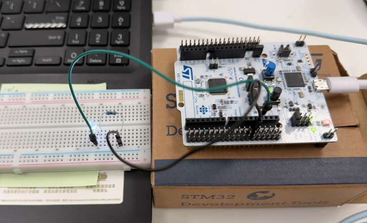
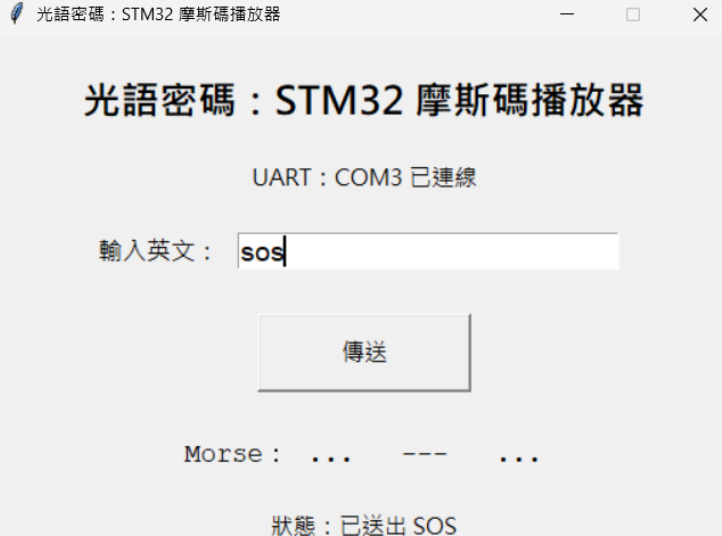

# 光語密碼 Light Code
NUCLEO-G474RE 期中專題

在高噪音工業環境中，口頭訊息可能因機械聲而難以辨識。本專題利用 Python GUI 輸入英文單字，透過 UART 傳送至 STM32，再由 STM32 將文字轉換成摩斯碼，最後使用板上 LED 以長短閃爍方式呈現訊息。

---

## 1. 情境故事

工廠內大型機械與自動化設備同時運轉時，環境噪音可能使現場人員難以清楚聽見短碼或英文單字，造成訊息誤傳。

因此，本專題以「視覺光訊號」取代部分聲音傳遞方式。

使用者在電腦端輸入英文單字後，STM32 會將英文轉換成摩斯碼，並利用板上 LED 的短亮與長亮來傳遞訊息。

例如輸入：

```text
SOS
```

STM32 會轉換成：

```text
... --- ...
```

LED 顯示為：

```text
短、短、短
長、長、長
短、短、短
```

---

## 2. 故事對照：真實設備 → Demo 替身

| 故事情境中的設備 | Demo 使用方式 | 微算機技術 |
|---|---|---|
| 中控室訊息輸入介面 | Python GUI / PySerial | USART2 UART 通訊 |
| 訊息暫存與處理區 | Ring Buffer 128 bytes | UART 中斷接收、主迴圈處理 |
| 工廠視覺警示燈 | NUCLEO-G474RE 板上 LD2 | PA5 GPIO Output |
| 英文訊息編碼器 | STM32 程式 | Morse Table 查表轉換 |

系統流程：

```text
Python GUI
    ↓
PySerial
    ↓
USART2
    ↓
Ring Buffer
    ↓
STM32 Morse Encoder
    ↓
LD2 摩斯碼閃爍
```

---

## 3. 功能與驗收條件

### 驗收一：UART 單字傳送與完整接收

動作：

在 Python GUI 中輸入：

```text
SOS
```

並按下「傳送」。

預期結果：

STM32 透過 USART2 收到：

```text
SOS\n
```

UART 中斷將資料逐 byte 放入 Ring Buffer，主迴圈從 Ring Buffer 取出資料，直到收到 `\n` 後判定一個完整單字接收完成。

實測結果：

板上 LED 開始播放對應的摩斯碼。

結果：

```text
通過
```

---

### 驗收二：摩斯碼 LED 播放

動作：

輸入：

```text
SOS
```

預期結果：

```text
S = ...
O = ---
S = ...
```

時間設定：

```text
Dot  = 200 ms
Dash = 600 ms
```

亦即點與劃採用：

```text
1 : 3
```

的時間比例。

實測結果：

板上 LD2 可觀察到：

```text
三短、三長、三短
```

結果：

```text
通過
```

---

## 4. 第 3～7 週技術勾選

本專題實際使用的技術如下。

| 技術項目 | 使用狀態 | 用途 |
|---|---|---|
| GPIO 輸出 | ☑ | PA5 / LD2 控制摩斯碼亮滅 |
| GPIO 輸入 | ☐ | 未使用 |
| 複用功能 AF | ☑ | PA2 / PA3 作為 USART2 TX / RX |
| PLL 系統時脈 | ☑ | 系統時脈 170 MHz |
| UART 傳送 | ☑ | STM32 回傳 RX / PLAYING / DONE |
| UART 接收＋Ring Buffer | ☑ | USART2 中斷接收資料並放入環形緩衝區 |
| 外部中斷 EXTI | ☐ | 未使用 |
| NVIC 致能 | ☑ | USART2 RX 中斷 |
| 優先權與巢狀 | ☐ | 未特別使用多中斷巢狀 |
| 軟體去彈跳 | ☐ | 未使用按鈕 |
| Timer 定時中斷 | ☐ | 摩斯碼時間目前使用 HAL_Delay |
| PWM | ☐ | LED 使用 GPIO HIGH / LOW 控制 |
| 輸入捕捉 | ☐ | 未使用 |

目前實際使用：

```text
6 / 13 項
```

---

## 5. 腳位表

使用開發板：

```text
NUCLEO-G474RE
```

主要腳位如下：

| 腳位 | 功能 | 用途 |
|---|---|---|
| PA2 | USART2_TX | STM32 傳送資料至電腦 |
| PA3 | USART2_RX | STM32 接收電腦傳送資料 |
| PA5 | GPIO Output | 板上 LD2，播放摩斯碼 |

UART 設定：

```text
Baud Rate : 115200
Data Bits : 8
Parity    : None
Stop Bits : 1
Mode      : TX / RX
```

PA2 / PA3 透過 ST-LINK Virtual COM Port 與電腦通訊，因此不需要額外接 UART 線。

---

## 6. 建置與執行方式

### STM32 開發環境

使用：

```text
STM32CubeMX
STM32CubeIDE
```

MCU：

```text
STM32G474RE
```

系統時脈：

```text
HSI16 ÷ 4 × 85 ÷ 2
= 170 MHz
```

USART2：

```text
115200 8N1
PA2 = TX
PA3 = RX
```

PA5：

```text
GPIO Output
```

---

### STM32 執行流程

程式啟動後先執行：

```c
HAL_UART_Receive_IT(&huart2, &rx_byte, 1);
```

開始 USART2 中斷接收。

接收完成後進入：

```c
HAL_UART_RxCpltCallback()
```

每次收到一個 byte 後：

1. 將資料放入 Ring Buffer
2. 更新 `rx_head`
3. 再次啟動下一次 UART 接收

主迴圈則從 Ring Buffer 取出資料。

當收到：

```c
'\n'
```

代表一個完整單字接收完成。

接著 STM32 將文字轉換成摩斯碼並控制 LED 播放。

---

### Python 開發環境

使用：

```text
Python
PySerial
Tkinter
VS Code
```

安裝 PySerial：

```bash
pip install pyserial
```

查看目前 STM32 使用的 COM Port：

```bash
python -m serial.tools.list_ports
```

例如顯示：

```text
COM3 - STMicroelectronics STLink Virtual COM Port
```

則 Python 程式設定為：

```python
PORT = "COM3"
```

執行程式：

```bash
python mid_prj_UART_test.py
```

開啟 GUI 後輸入：

```text
SOS
```

按下：

```text
傳送
```

STM32 即開始播放：

```text
... --- ...
```

---

## 7. 程式結構

### UART Ring Buffer

UART 中斷不直接處理完整字串。

中斷只負責：

```text
接收 byte
↓
放入 Ring Buffer
↓
更新 head
↓
重新開啟 UART Receive Interrupt
```

這樣可以避免在 ISR 中執行過多工作。

Ring Buffer 大小：

```c
#define RX_BUF_SIZE 128
```

主要變數：

```c
volatile uint8_t rx_buf[RX_BUF_SIZE];
volatile uint16_t rx_head;
volatile uint16_t rx_tail;
```

主迴圈使用：

```c
UART_ReadByte()
```

將資料從 Ring Buffer 逐 byte 取出。

---

### Morse Table

程式建立 A～Z 的摩斯碼查表：

```c
const char *morse_table[26];
```

例如：

```text
A = .-
S = ...
O = ---
```

字元可透過：

```c
morse_table[c - 'A']
```

取得對應摩斯碼。

---

### Morse LED 播放

時間單位：

```c
#define MORSE_UNIT 200
```

點：

```text
200 ms
```

劃：

```text
600 ms
```

LED 使用：

```c
HAL_GPIO_WritePin(GPIOA, GPIO_PIN_5, GPIO_PIN_SET);
```

點亮。

使用：

```c
HAL_GPIO_WritePin(GPIOA, GPIO_PIN_5, GPIO_PIN_RESET);
```

熄滅。

---

## 8. 實作照片

### NUCLEO-G474RE 實機

使用 NUCLEO-G474RE 板上 LD2（PA5）作為摩斯碼輸出 LED。

## 8. 實作照片

### NUCLEO-G474RE 實機

使用 NUCLEO-G474RE 板上 LD2（PA5）作為摩斯碼輸出 LED。



```

---

### Python GUI

Python GUI 可輸入英文單字，並使用 PySerial 將文字透過 USART2 傳送給 STM32。

例如：

```text
輸入：SOS
Morse：... --- ...
狀態：已送出 SOS
```

### Python GUI

Python GUI 可輸入英文單字，並透過 PySerial 傳送至 STM32。



---

## 9. AI 使用說明

本專題部分程式與文件整理有使用 AI 工具協助。

AI 協助內容包括：

- Morse Code Table 初版產生
- UART Ring Buffer 程式架構整理
- Python GUI 初版程式
- README 與簡報文字整理

AI 產生內容並非直接視為完成結果。

本人透過以下方式進行確認與修正：

- 使用 STM32CubeMX 確認 PA2 / PA3 / PA5 腳位設定
- 使用 STM32CubeIDE Build 檢查 C 程式是否可正常編譯
- 實際使用 PySerial 傳送英文單字
- 實機觀察板上 LD2 摩斯碼閃爍結果
- 依 Build Error 與實測結果修改程式

因此最終 Demo 功能皆有經過實機測試與確認。

---

## 10. 已知限制

目前版本仍有以下限制：

1. 目前主要支援英文字母 A～Z。
2. Morse Code 播放時間目前使用 `HAL_Delay()` 控制，尚未改為 Timer 定時中斷。
3. LED 使用板上 LD2 作為工業警示燈的 Demo 替身，並非實際高亮度工業燈塔。
4. 系統目前主要示範單字型短訊息傳送。
5. PWM、Timer Interrupt 與 Input Capture 目前未使用。
6. 電腦端 COM Port 可能因 USB 重新插拔而改變，需要確認目前的 ST-LINK Virtual COM Port 編號。

---

## 專案流程總結

```text
Python GUI 輸入英文
        ↓
      PySerial
        ↓
USART2 115200 8N1
        ↓
 UART Interrupt
        ↓
  Ring Buffer
        ↓
解析完整英文單字
        ↓
 Morse Table
        ↓
 PA5 / LD2
        ↓
摩斯碼長短閃爍
```

以 `SOS` 為例：

```text
SOS
↓
... --- ...
↓
短短短 / 長長長 / 短短短
```

本專題以簡單的板上元件示範在高噪音環境下，如何將文字訊息轉換成可視化摩斯碼光訊號。# midterm_project